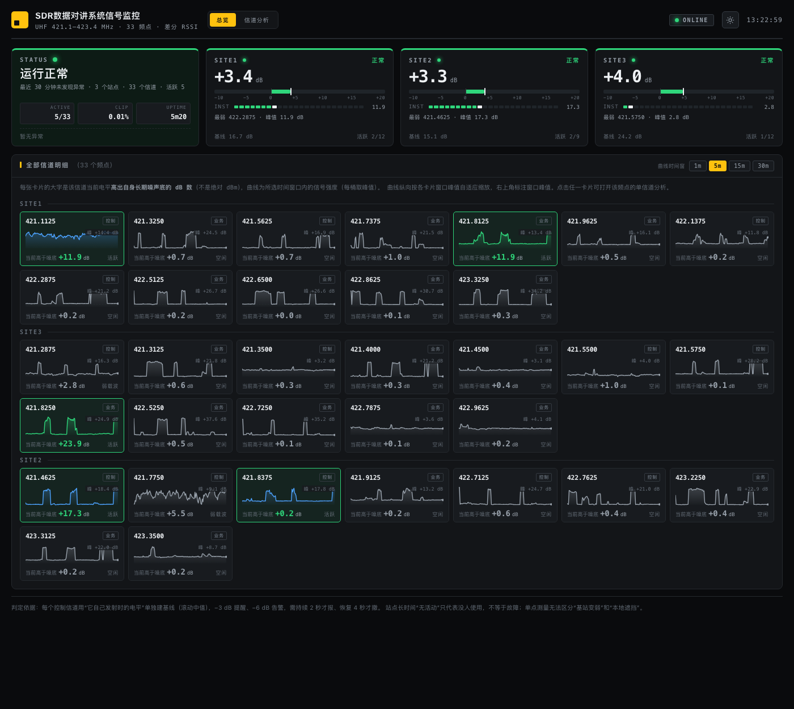
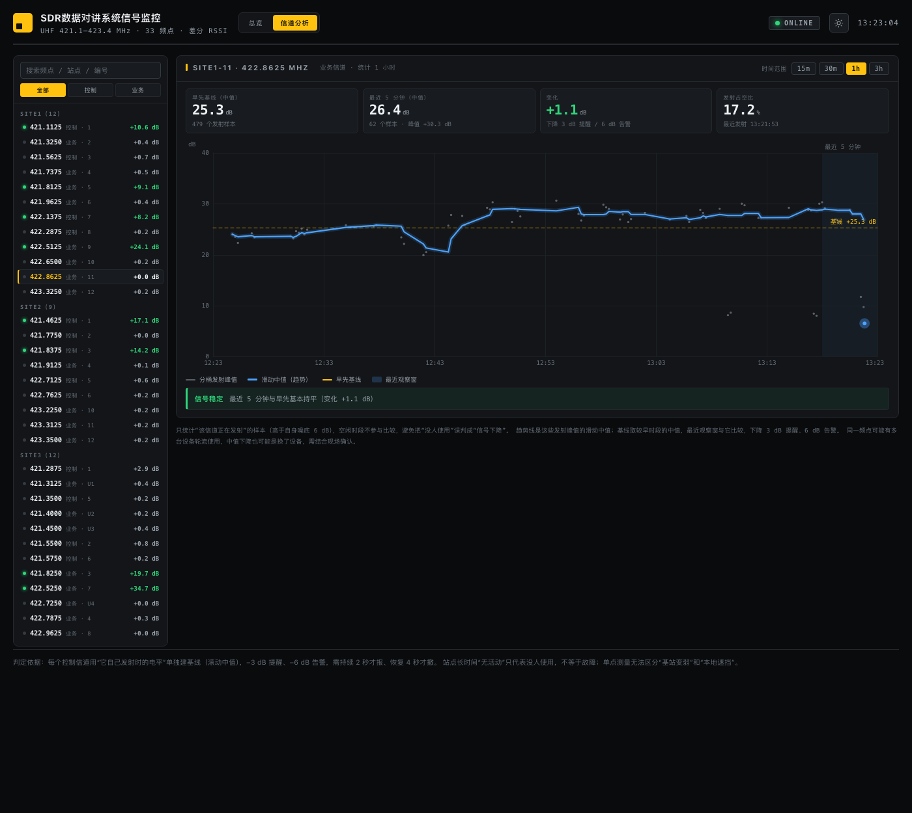

# SDR数据对讲系统信号监控

基于 RTL-SDR 的 UHF 对讲系统信号监控看板。一次 IQ 采集同时测量 33 个 12.5 kHz 信道，
用“信道功率减去同帧全带噪声底”的差分方式做长期趋势判断，尽量抵抗电视棒 AGC 漂移和温漂。

> **读数不是 dBm。** 页面上的 dB 都是相对值：`delta` 是相对同帧频谱噪声底的电平，
> `level` 是相对该信道自身长期噪声底的高度。设备未做功率校准，不能当绝对场强使用。

## 功能

- **总览**：站点状态、控制信道偏差、全部信道明细；每个频点带当前 dB 读数和时间窗曲线。
- **信道分析**：单独查看任意频点，过滤空闲时段，只看“有发射时”的信号；滑动中值趋势 + 早先基线 + 最近观察窗，直接给出“平稳 / 偏低 / 明显下降”的判定。
- **历史**：SQLite 落库，支持 15m / 30m / 1h / 3h 单信道分析。
- **主题**：深色 / 浅色；数据每 250 ms 刷新。
- **离线可用**：无外部 CDN/网络依赖，前端静态文件由同一个 Python 服务提供。

> **想让 AI 帮你部署或改功能？**
> 把 [`docs/AI_DEPLOY.md`](docs/AI_DEPLOY.md) 第 2 节的提示词整段发给 Claude Code / Codex / Cursor，
> 它会按 AGENTS.md 的约定探测环境、安装依赖、启动并验收；开发任务用第 5 节的提示词。
> 部署前建议先让 AI 阅读 [`AGENTS.md`](AGENTS.md)。

## 界面





## 硬件与运行环境

| 项目 | 要求 |
| --- | --- |
| SDR | RTL2832U 电视棒（代码按 FC0012 调优，其他 RTL-SDR 通常也可用），天线接在 421–423 MHz 频段 |
| 系统 | macOS（Apple Silicon / Intel）或 Linux |
| Python | 3.10+，仅需 `numpy` |
| 编译 | `clang` 或 `gcc`，以及 `librtlsdr` 开发头文件 |
| 浏览器 | 现代 Chrome / Edge / Safari / Firefox |
| 可选 | Node.js（只用于前端 JS 语法检查，不影响运行） |

> 本项目默认 2.56 MHz 采样、中心频率 422.23 MHz，覆盖约 420.97–423.49 MHz。
> 换频段需要同时修改 `dashboard.py` 顶部的 `FC` / `FS`，并更新 `channels.csv`。

## 快速开始

```bash
# 1. 进入项目目录
cd Radio

# 2. 建虚拟环境并安装 Python 依赖
python3 -m venv .venv
. .venv/bin/activate
pip install -r requirements.txt

# 3. 安装 librtlsdr（二选一）
brew install librtlsdr          # macOS
sudo apt install librtlsdr-dev  # Debian / Ubuntu

# 4. 直接启动；首次运行会自动编译 .bin/iqcap
python dashboard.py --port 8787
```

浏览器打开 <http://127.0.0.1:8787>。

如果启动时报找不到头文件/库，请设置编译环境变量后重试：

```bash
# Apple Silicon Homebrew（默认值）
BREW_PREFIX=/opt/homebrew python dashboard.py

# Intel Mac Homebrew
BREW_PREFIX=/usr/local python dashboard.py

# Linux（头文件/库在 /usr）
BREW_PREFIX=/usr CC=gcc python dashboard.py
```

启动成功会打印：

```text
仪表台: http://127.0.0.1:8787  (信道 33, 中心 422.230 MHz)
```

### 远程访问

服务默认只监听 `127.0.0.1`，**没有登录鉴权**。建议用 SSH 隧道，而不是直接暴露端口：

```bash
ssh -L 8787:127.0.0.1:8787 user@采集机
# 本机浏览器打开 http://127.0.0.1:8787
```

确需局域网访问时可加 `--host 0.0.0.0`，但请自行加防火墙 / 反向代理 / 访问控制。

## 配置

### `channels.csv`

```csv
site,repeater_id,is_control,downlink_mhz,uplink_mhz
Site1,1,1,421.1125,411.1125
Site1,2,0,421.3250,411.3250
```

- `site`：站点名，会显示在看板上。
- `repeater_id`：中继台编号，允许 `U1`、`U2` 这类字符串。
- `is_control`：`1` 控制信道，`0` 业务信道。
- `downlink_mhz`：监控的下行频点，必须在采集带宽内；不在带宽内的行会被忽略。
- `uplink_mhz`：当前版本不参与采集，仅为记录。

采集带宽之外的频率需要同时修改 `dashboard.py` 顶部的 `FC`（中心频率）和 `FS`（采样率），
并确认 RTL-SDR 与天线支持该频段。

### 采集参数

`dashboard.py` 顶部常量：

| 常量 | 默认 | 含义 |
| --- | --- | --- |
| `N` | 8192 | FFT 点数 |
| `FS` | 2 560 000 | 采样率 Hz |
| `FC` | 422 230 000 | 中心频率 Hz |
| `HALF` | 6250 | 信道半宽 Hz（12.5 kHz 信道） |
| `ON_DB` / `OFF_DB` | 8 / 4 | 判定“有载波 / 载波消失”的阈值 |
| `ON_TICKS` / `OFF_TICKS` | 4 / 8 | 连续确认次数（去抖） |
| `WARN_DB` / `BAD_DB` | 3 / 6 | 相对基线下降的提醒 / 告警阈值 |

`iqcap` 以 `增益 192(19.2 dB) + AGC=1` 启动。这颗 FC0012 的调谐器增益档基本无效，
RTL2832U 内部 AGC 是唯一有效的电平控制；**不要随意关闭 AGC**，否则削顶会从 <1% 升到 30% 以上。

### 命令行参数

```text
python dashboard.py [--host 127.0.0.1] [--port 8787] [--db rssi.db] [--channels channels.csv]
```

## 部署为常驻服务

### macOS（launchd）

模板见 [`deploy/com.radio.dashboard.plist.example`](deploy/com.radio.dashboard.plist.example)：

```bash
cp deploy/com.radio.dashboard.plist.example \
   ~/Library/LaunchAgents/com.radio.dashboard.plist
# 修改文件里的 __PROJECT_DIR__ / __PYTHON__
launchctl load ~/Library/LaunchAgents/com.radio.dashboard.plist
launchctl list | grep radio
```

停止 / 重启：

```bash
launchctl unload ~/Library/LaunchAgents/com.radio.dashboard.plist
launchctl load   ~/Library/LaunchAgents/com.radio.dashboard.plist
```

### Linux（systemd）

模板见 [`deploy/radio-dashboard.service`](deploy/radio-dashboard.service)：

```bash
sudo cp deploy/radio-dashboard.service /etc/systemd/system/
sudo systemctl daemon-reload
sudo systemctl enable --now radio-dashboard
sudo systemctl status radio-dashboard
journalctl -u radio-dashboard -f
```

运行用户需要有 USB 访问权限（通常加入 `plugdev` 组），并确保没有其他进程占用电视棒。

### 临时运行

```bash
nohup .venv/bin/python dashboard.py --port 8787 >> dashboard.log 2>&1 &
```

同一台机器、同一支 SDR **只能有一个采集进程**。同时运行两个 dashboard 会出现
`usb_claim_interface error -3`，两个实例都拿不到数据。

## 数据与维护

数据库默认是项目目录下的 `rssi.db`：

```sql
CREATE TABLE samples(ts REAL, key TEXT, mhz REAL, delta REAL, level REAL);
CREATE INDEX idx_samples_key_ts ON samples(key, ts);
```

- 正常运行时每约 2 秒写一轮（`DB_EVERY=4`），33 个信道合计约 16.5 行/秒。
- 满负荷约 **140 万行/天**，磁盘约 **100 MB/天**（含索引）。
- 默认**不自动清理**。长期运行请定期删除旧数据，建议保留 3–7 天：

```bash
# 建议先停服务，避免 VACUUM 与写入互相等待
sqlite3 rssi.db "DELETE FROM samples WHERE ts < strftime('%s','now') - 7*86400; VACUUM;"
```

- 在线备份（服务运行时也可）：

```bash
sqlite3 rssi.db ".backup 'rssi-$(date +%F).db'"
```

- 为了分析页的历史，服务启动时会回读最近 3 小时的 `delta` 建立噪声底，并从最近 30 分钟恢复曲线。
- 删除 `rssi.db` 会清空历史与基线，站点状态需要重新积累发射样本才能判定。

## HTTP API

服务同时提供静态页面和 JSON API（`Cache-Control: no-store`）：

| 路径 | 说明 |
| --- | --- |
| `GET /api/state` | 当前快照：设备状态、全部信道、站点判定、问题列表 |
| `GET /api/chan-trend?range=300` | 全部信道最近曲线，`range` 最大约 30 分钟（内存窗口） |
| `GET /api/chan-detail?key=Site1-11&range=3600` | 单信道分析：发射峰值点、早先基线、最近中值、变化、判定 |

字段和计算方式见 [`docs/ARCHITECTURE.md`](docs/ARCHITECTURE.md)。

示例：

```bash
curl -s http://127.0.0.1:8787/api/state | python3 -m json.tool | head
curl -s 'http://127.0.0.1:8787/api/chan-detail?key=Site1-11&range=3600' | python3 -m json.tool
```

## 故障排查

| 现象 | 原因 / 处理 |
| --- | --- |
| `No supported devices found` / 找不到 SDR | 电视棒未插好、USB 线/口故障、Linux 权限不足或驱动未加载。先运行 `rtl_test -t`；Linux 检查 `lsusb` 和 plugdev/udev。 |
| `usb_claim_interface error -3` / `device busy` | 已有另一个 `iqcap` / dashboard 占用 SDR。`pgrep -fl iqcap`、`pgrep -fl dashboard.py` 找到并停掉旧进程，只保留一个。 |
| `open fail (device busy?)` | USB 被其他软件（rtl_tcp、GQRX、SDR# 等）占用；关闭后重试。 |
| Linux 报 `Kernel driver is active` | DVB 驱动占用。按 rtl-sdr 文档卸载/黑名单 `dvb_usb_rtl28xxu`，或重启后先运行 `rtl_test -t` 验证。 |
| `ModuleNotFoundError: numpy` | 没有进入 venv 或没安装依赖：`pip install -r requirements.txt`。 |
| `clang: error: ... librtlsdr` | 没装 `librtlsdr`，或 `BREW_PREFIX` 路径不对（Apple Silicon `/opt/homebrew`，Intel `/usr/local`，Linux `/usr`）。 |
| 页面显示“数据停止更新” | 采集进程还在但 SDR 掉线/卡死；看 dashboard 日志、重新插拔电视棒、确认没有第二个进程。 |
| `CLIP` 大于 2% | 输入过载，读数不可信。加衰减器或降低前端增益；不要用 AGC 关闭来“解决”。 |
| 页面打开是旧版本 | 浏览器缓存；强制刷新（macOS `Cmd+Shift+R`）。后端改过 Python 后需要重启进程。 |
| 曲线一直“样本不足” | 该频点近期确实没有发射，或刚启动还没积累到足够样本；不是故障。 |
| 端口被占用 | `lsof -i :8787`，换 `--port` 或停掉旧服务。 |

更细的原理和限制见 [`docs/ARCHITECTURE.md`](docs/ARCHITECTURE.md)。

## 开发

前端没有构建步骤，`web/` 下的文件由 Python 静态服务直接返回，改完刷新即可：

```text
web/index.html   页面结构、两个 Tab、内联说明
web/style.css    深/浅色变量、布局、卡片、图表样式
web/app.js       轮询、总览曲线、单信道分析、Canvas 绘制
```

后端单文件 `dashboard.py`：

```text
Engine   采集线程、差分计算、状态机、SQLite、分析接口
Handler  HTTP 服务（静态文件 + JSON API）
```

常用检查：

```bash
python3 -m py_compile dashboard.py
node --check web/app.js          # 没有 Node 可跳过
bash scripts/smoke_test.sh       # 服务启动后做端到端冒烟
```

### 用 AI 快速部署 / 开发

- 面向 AI 编码代理的工程约定：[`AGENTS.md`](AGENTS.md)
- 可直接粘给 AI 的部署提示词与验收清单：[`docs/AI_DEPLOY.md`](docs/AI_DEPLOY.md)
- 架构、数据流、判定算法、API 字段：[`docs/ARCHITECTURE.md`](docs/ARCHITECTURE.md)

推荐流程：让 AI 先读这三份文档，再执行 `scripts/smoke_test.sh` 和页面验证；
涉及频率、增益、判定阈值的改动必须人工确认。

## 已知限制

- 单接收机、单天线：无法区分“基站功率下降”和“本地遮挡/天线变差”。
- 读数未校准，不能与 dBm 或其它设备直接比较。
- 业务信道可能由多台设备轮流使用，发射强度中值下降不一定是基站功率问题。
- 信道空闲时无法测量信号；页面会显示“无有效发射”，这是信息不足，不是故障。
- 没有账号体系；默认只监听本机。
- 无自动数据保留策略；长期运行请按上文清理 `rssi.db`。

## 目录结构

```text
.
├── dashboard.py                 # 采集 + 判定 + HTTP 服务（主程序）
├── channels.csv                 # 信道表
├── rssi.db                      # SQLite 历史（运行时生成）
├── iqcap.c / .bin/iqcap         # 最小 IQ 采集器（首次启动自动编译）
├── rtl_multi_monitor.py         # 早期多信道原型，非主程序
├── sdr_rssi_monitor.py          # 早期单信道原型，非主程序
├── web/                         # 前端（无构建步骤）
├── scripts/smoke_test.sh        # 端到端冒烟检查
├── deploy/                      # launchd / systemd 模板
├── docs/                        # 架构与 AI 部署文档
├── AGENTS.md                    # AI 编码代理指南
└── requirements.txt
```
